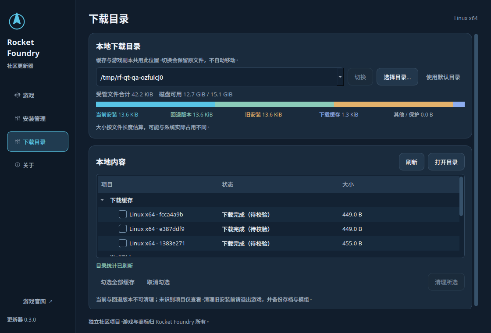

# Rocket Foundry Updater 0.5

[简体中文](README.md) | **English**

An independent, community-maintained cross-platform desktop launcher: check official builds, resumable downloads, installation, verification, launch and rollback. It provides a **dark PySide6/Qt interface with visual local directory management**. 0.4 added game-running awareness, automatic download retries, tray notifications, periodic checks and diagnostic logging; 0.5 adds **Simplified Chinese / Traditional Chinese / English localization** with automatic switching based on the machine locale. Supports Windows x64, Linux x64 and Apple Silicon macOS (14+). The game itself is not included.



## Getting started

With a packaged build, extract the whole directory and open `RF-Updater`, `RF-Updater.exe` or the macOS `.app`; no Python installation is required. Do not move a single executable out of its directory. Local Linux builds are limited by the build machine's glibc version; see the verification notes below.

Running from source requires Python 3.11+ and the declared Qt dependency:

```sh
python -m venv .venv
# activate .venv, then
python -m pip install .
python -m rf_updater
```

On Linux you can use `python3`, on Windows `py`. The GUI dependency is pinned to `PySide6==6.12.0`; Linux also needs system libraries for the Qt platform plugins — on Debian/Ubuntu typically `libxcb-cursor0`, `libxkbcommon-x11-0`, `libegl1`, `libopengl0`. See the CI workflow for the full installation steps. The Qt version no longer needs Tk. The official PySide6 6.12 wheel has a macOS baseline of 14.

The CLI still imports the GUI lazily: running `status`, `check`, `install` etc. from source only needs the standard library and never initializes Qt or requires a display.

After a local Linux build, run `python -m scripts.install_linux --launch` in the project directory to install and open it. The script verifies the bundled checksum, keeps older programs, updates `~/.local/bin/rf-updater` and the application menu entry, and never migrates or deletes game data.

## Interface and directory management

- The **Game** page highlights installation state and the primary action. With a game installed, **Launch game** stays available; when a new build exists, **Update game** appears alongside it. Launching remains possible while checking or when the network fails.
- **Install Management** gathers the copyable data path, file verification, reinstall and rollback; detailed paths, ETag, SHA-256 and verification scope expand on demand.
- **Download Directory** lets you choose and remember a local data location, switch between recent locations or restore the default; it shows categorized sizes (cache, current install, rollback version, old installs, unrecognized items) and free disk space.
- Cache or old installs can be checked for cleanup. The current and rollback versions are always protected; links and unrecognized items are view-only. Cleaning old installs requires confirming that the game was exited and saves/mods were backed up. Deletion is irreversible and may partially succeed.
- The global task area shows download/verify/extract/complete phases, per-phase percentage and download speed. Switching pages neither cancels tasks nor forces a jump back to the home page.
- Failures provide an explanation, detailed error and retry; after cancelling an install, **Continue installation** resumes when the official response's validators and Range support allow it. Failed verification offers a one-click **Reinstall to repair**.
- **Game-running awareness**: a launch records a session (PID and executable path); the UI shows "Running" and disables update, rollback and old-install cleanup, restoring them automatically when the process exits. A PID reused by another program is not misdetected.
- **Automatic download retries**: network interrupts or truncated transfers retry up to 3 times with 2s/8s/32s backoff, keeping downloaded progress via resume; checksum mismatches, HTTP errors and build changes are never retried.
- **Tray and notifications**: when a system tray is available, a menu offers show window / check for updates / quit; results of install, verify, rollback and cleanup are sent as desktop notifications while the window is not in the foreground (can be disabled on the About page).
- **Periodic checks**: while the window is open, updates are checked every 4 hours by default; toggle on the About page. This is not a background service — it stops when the window closes.
- Default window 1120×760, minimum 900×640; narrow windows hide the orbit artwork and long pages scroll. System title bar, standard controls, keyboard focus and hi-DPI scaling are preserved.
- **Multilingual**: UI, engine errors and CLI messages support Simplified Chinese, Traditional Chinese and English; the first launch selects the language from the machine locale, and system language changes are followed at runtime. See "Languages" below.

The first launch checks the official package; click **Install game** to download and install. The game does not start automatically with the updater. A successful launch request does not prove the game actually runs — open `logs/game.log` from the task notice.

Exit the game and back up saves before updating or rolling back. The updater blocks update, rollback and old-install cleanup while it detects the game running, but detection cannot cover every launch method (e.g. starting the game outside the updater, some script-wrapper cases); the textual reminders still apply. Rollback only switches the game program; it does not migrate or restore saves, and older versions may not read newer saves. Game file locations are authoritative in-game under `MORE → Guide → Your files`.

## Downloads, installation and data

Complete packages are fetched from the official HTTPS endpoints:

| Platform | Official endpoint | Format |
| --- | --- | --- |
| Windows x64 | `https://api.rocketfoundry.net/download/windows` | ZIP |
| Apple Silicon macOS | `https://api.rocketfoundry.net/download/macos` | ZIP |
| Linux x64 | `https://api.rocketfoundry.net/download/linux` | TAR.GZ |

Endpoint source: [official download page](https://rocketfoundry.net/play/). Mobile platforms continue to use Google Play, APK or TestFlight from the official site. The UI shows real build metadata and never invents game version numbers; when comparison is impossible it says so explicitly.

HTTPS verifies certificates and hostnames; standalone bundles ship the Mozilla public CA bundle, while source runs use the system/OpenSSL default trust roots. When an official SHA-256 is provided it is checked; otherwise transfer length and archive integrity are verified and a local digest is stored. **A local digest does not prove publisher identity and does not replace an official signature.**

Downloads support cancellation, resume and build-change detection. Extraction rejects path traversal, link escapes, device files, duplicate paths and oversized content, and explicitly reads the gzip trailer to verify CRC. Each install creates an independent directory; on success the record is switched atomically, and failures never overwrite the existing installation. An OS file lock prevents concurrent changes to the same directory.

Installation records keep `state.json` schema 1; no migration is needed. Without a saved custom location, these defaults apply:

| System | Default directory |
| --- | --- |
| Windows | `%LOCALAPPDATA%/RF-Updater` |
| macOS | `~/Library/Application Support/RF-Updater` |
| Linux | `${XDG_DATA_HOME:-~/.local/share}/RF-Updater` |

```text
RF-Updater/
  state.json                 pointers to the current and previous installs
  game-session.json          last launch session (PID, executable) for running awareness
  .updater.lock              OS lock file; never delete it
  cache/<build-id>.part      download cache, kept after completion
  cache/<build-id>.json      resume metadata
  installs/<build-id>-<ID>/
    game/                    game files
    receipt.json             installation record and file digests
  logs/game.log              game output, appended per launch
  logs/updater.log           updater diagnostics (JSON lines, 1 MB rotation, 3 backups)
```

A writable local location can be chosen in **Download Directory**; switching only changes where this window downloads and installs next — files in the original directory are kept and never moved automatically. A directory with a valid existing installation record is recognized directly. Up to 12 recent locations are remembered and you can return to the original one; other open windows keep their own locations.

The directory choice also applies to the next launch and to the CLI; an explicit `--root` takes precedence and does not rewrite the saved choice. When a saved location becomes unavailable, the updater asks you to connect the disk or choose another location — it never recreates it on another volume.

Directory preferences are stored separately in `directories.json`: Linux uses `${XDG_CONFIG_HOME:-~/.config}/RF-Updater/`, Windows `%LOCALAPPDATA%/RF-Updater/`, macOS `~/Library/Preferences/RF-Updater/`. If the settings are damaged, open with `--root` first, then re-select a location in the UI to repair them. `settings.json` in the same directory stores the periodic-check and notification toggles plus the language; damage silently restores defaults without blocking the UI.

Old installs and cache are never deleted automatically; clean them up by checking items on the directory page. New installs do not copy custom data from old directories. Unrecognized, leftover or incompletely measurable items are view-only; open their directory to inspect them yourself. Sizes are estimated from file lengths; scans never follow symbolic links or Windows junctions.

Full-package updates, manual installation and rollback remain the model. There is no historical build download, delta patching, accounts or updater self-update; periodic checks only run while the window is open and are not a background service.

## Languages

Supported: `zh-CN` (Simplified Chinese, source language), `zh-TW` (Traditional Chinese, covering zh-TW/zh-HK/zh-MO), `en` (English).

- **Automatic detection**: the GUI reads the OS locale (`QLocale.system()`) at startup; Traditional Han script or TW/HK/MO regions map to zh-TW, other Chinese to zh-CN, everything else to en. In follow-system mode the locale is re-detected on every launch, and a runtime system locale change (`LocaleChange`) switches immediately.
- **Manual override**: the About page language combo offers Follow system / 简体中文 / 繁體中文 / English; the choice applies immediately without restarting and is stored in the `language` field of `settings.json` in the configuration directory (`null` = follow system).
- **CLI**: detection order `RF_UPDATER_LANG` > `LC_ALL` > `LC_MESSAGES` > `LANG`; when none is set, Simplified Chinese is used. Example: `RF_UPDATER_LANG=en python -m rf_updater status`.
- Qt standard dialogs (file picker, standard buttons) load the `qtbase_*.qm` files shipped with PySide6; fonts are chosen per language (Traditional Chinese prefers Microsoft JhengHei / PingFang TC / Noto CJK TC).
- Catalogs live in `rf_updater/locales/*.json` (340 keys); missing keys fall back to Simplified Chinese. Dates stay ISO-style and size units stay B/KiB/MiB/GiB. See the [localization guide](docs/en/localization.md) for adding languages and key conventions.

## Command line

```sh
python -m rf_updater check
python -m rf_updater install
python -m rf_updater status
python -m rf_updater verify
python -m rf_updater launch
python -m rf_updater rollback
python -m rf_updater --root /path/to/data gui
```

`install` re-checks and installs the latest official build, including reinstalling the same build. Exit codes: 0 success, 1 failure, 130 keyboard interrupt. JSON results go to stdout; progress and errors go to stderr. The Windows console-less bundle is mainly for the GUI; use the source entry point for automation output.

## Testing and building

```sh
python -m pip install -e . -r requirements-build.txt
QT_QPA_PLATFORM=offscreen python -m unittest discover -v
# real X11 window on Linux
xvfb-run -a env QT_QPA_PLATFORM=xcb python -m scripts.qa_gui --screenshots docs/qa/qt
# hi-DPI acceptance
QT_QPA_PLATFORM=offscreen QT_SCALE_FACTOR=1.5 python -m scripts.qa_gui
QT_QPA_PLATFORM=offscreen QT_SCALE_FACTOR=2 python -m scripts.qa_gui
# package on each target OS
python -m scripts.build
```

In PowerShell set test environment variables like `$env:QT_QPA_PLATFORM='offscreen'`. Tests use loopback HTTP and tiny synthetic packages; they never download or run the real game (running-awareness tests use a local sleep fixture process). The suite pins Simplified Chinese so assertions are independent of the machine locale. QtTest acceptance covers parallel check and launch, offline launch, visible-control clicks, cancel/resume, page switching, error retry, close cleanup, confirmation cancel and stale-result isolation, plus directory choice/memory/switch-back, offline directory recovery, scan cancellation, protected items and cleanup confirmation; 0.4 added running-state disable/recovery, one-click verify repair, settings persistence and periodic-check/notification toggles; 0.5 added language switching and persistence, initialization auto-detection, LocaleChange following and English minimum-window layout. `python -m scripts.i18n_report` validates key and parameter parity across the three catalogs.

Control screenshots in `docs/qa/qt` come from synthetic test installs; their dates, package sizes and digests do not represent real official versions. Historical `docs/qa` screenshots belong to 0.1. See the verification records: [0.2 Qt redesign](docs/verification-0.2.md), [0.3 directory management](docs/verification-0.3.md), [0.4 running awareness & resilience](docs/verification-0.4.md), [0.5 localization](docs/verification-0.5.md) (Chinese).

Builds use PyInstaller 6.22.3, certifi 2026.10.23 and the pinned PySide6. `dist/` contains the native onedir program, an archive and its `.sha256`. Qt uses only Core, Gui and Widgets; native desktop plugins and licenses are collected, while WebEngine, QML, PDF and Tk are excluded. The bundled [third-party licenses](docs/third-party/README.md) preserve QtBase's original licenses and attribution.

The [CI workflow](.github/workflows/ci.yml) runs core tests, Qt control tests, hi-DPI checks, native packaging and window smoke tests on three platforms. Linux builds on Ubuntu 22.04 and runs real X11 windows through Xvfb. The workflow only uploads artifacts; it does not publish releases.

The local Linux build uses glibc 2.43 and is only accepted on the current system; for older distributions use the source or a matching baseline build. Remote CI has fully passed on all three platforms (tests, hi-DPI, packaging and window smoke; see the [0.5 verification record](docs/verification-0.5.md), Chinese). Code signing and macOS notarization still require their respective environments.

## Implementation

The Qt interface keeps theme, controls and task coordination in `rf_updater/ui/`. QObject workers call the existing Engine on threads; the main thread updates the UI through signals. Check tasks and change tasks are tracked independently, and closing the window waits for threads to finish safely.

Networking, restricted extraction, transactional installation and the CLI share the standard-library engine. Before launching the game or system applications, shared-library paths are restored and only Qt plugin paths pointing into the bundle are removed, preserving the user's external configuration. See the [architecture overview](docs/en/architecture.md) and the historical [design notes](docs/design.md) (Chinese).

Directory management lives in `storage.py` and `preferences.py`, running scans, switches and cleanup in the background; cleanup holds the directory lock and re-reads installation state, validating the whole selection before deleting item by item. Scans inspect at most 250,000 filesystem nodes and display 2,000 items, stopping beyond those limits to keep the UI responsive.

0.4's running awareness is implemented in `engine.py` via session records and process probing (Linux `/proc`, Windows `QueryFullProcessImageNameW`, macOS `proc_pidpath`), polled by the GUI every 2 seconds; download retries use cancellable backoff waits inside the engine; diagnostics live in `logbook.py`, opening and closing the file per event with no persistent handle, and never recreating a disconnected data directory.

0.5's localization uses the standard-library-only `i18n.py` plus JSON catalogs, so the engine and CLI never depend on Qt; static GUI text is reset through `retranslate()` and dynamic text renders through `t()` every frame, making language switches immediate. Qt standard dialogs are translated separately via `qtbase_*.qm`.

## Documentation

- [Documentation index](docs/README.md) (bilingual)
- [Changelog](CHANGELOG.md) (bilingual)
- Architecture: [中文](docs/architecture.md) / [English](docs/en/architecture.md)
- Testing & building: [中文](docs/testing.md) / [English](docs/en/testing.md)
- Localization: [中文](docs/localization.md) / [English](docs/en/localization.md)

## License

Project code is MIT licensed. Rocket Foundry's game, trademarks and assets belong to their rights holders; this project is not affiliated with the official team.
