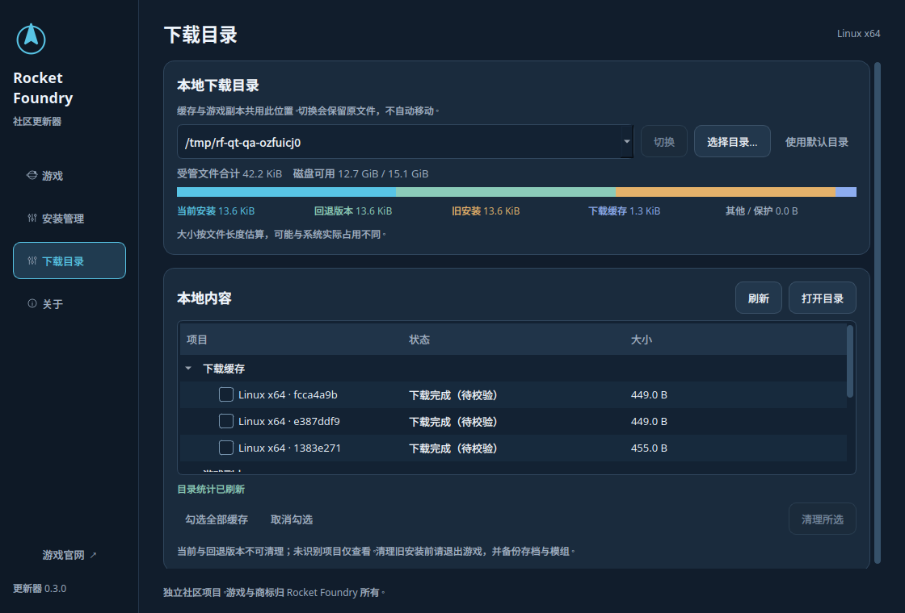

# Rocket Foundry 更新器 0.5

**简体中文** | [English](README.en.md)

独立社区维护的跨平台桌面启动器：检查官方构建、断点续传、安装、校验、启动与回退。提供 **PySide6/Qt 深色界面与可视化本地目录管理**，0.4 新增游戏运行感知、下载自动重试、托盘通知、定时检查与诊断日志，0.5 新增**简体中文 / 繁体中文 / English 三语言本地化**（按机器区域标识自动切换）。支持 Windows x64、Linux x64 和 Apple Silicon macOS（14 及以上）。游戏本体不包含在项目中。



## 启动与安装

使用已打包程序时，解压整个目录后打开 `RF-Updater`、`RF-Updater.exe` 或 macOS `.app`，无需安装 Python。不要只移动目录中的单个可执行文件。Linux 本机构建受构建机 glibc 版本限制，见下方验证说明。

从源码启动需要 Python 3.11+ 及项目声明的 Qt 依赖：

```sh
python -m venv .venv
# 激活 .venv，然后
python -m pip install .
python -m rf_updater
```

Linux 可使用 `python3`，Windows 可使用 `py`。GUI 依赖固定为 `PySide6==6.12.0`；Linux 还需要 Qt 平台插件的系统库，Debian/Ubuntu 通常需 `libxcb-cursor0`、`libxkbcommon-x11-0`、`libegl1`、`libopengl0`。完整 CI 安装步骤见工作流。Qt 版不再需要 Tk。官方 PySide6 6.12 wheel 的 macOS 基线为 14。

命令行仍延迟导入 GUI：直接从源码运行 `status`、`check`、`install` 等命令只需标准库，不会初始化 Qt 或要求显示器。

本地 Linux 构建完成后，可在项目目录运行 `python -m scripts.install_linux --launch` 安装并打开。脚本核对随包摘要，保留旧程序，更新 `~/.local/bin/rf-updater` 与应用菜单入口，不迁移或删除游戏数据。

## 界面与目录管理

- “游戏”页突出安装状态和主操作。已有游戏时保留 **启动游戏**，有新构建时另外显示 **更新游戏**；检查中或网络异常时仍可发起启动。
- “安装管理”集中显示可复制的目录、文件校验、重新安装和回退；详细路径、ETag、SHA-256 与校验范围按需展开。
- **“下载目录”** 可选择并记住本地数据位置、切换最近使用目录或恢复默认位置；显示缓存、当前安装、回退版本、旧安装和未识别项目的分类大小与磁盘可用空间。
- 可勾选缓存或旧安装进行清理。当前与回退版本始终保护，链接和未识别项目仅查看。清理旧安装须确认已退出游戏并备份存档、模组。删除不可撤销，失败可能部分清理。
- 全局任务区域显示下载、校验、解压、完成阶段、当前阶段百分比和下载速度。切换页面不取消任务，也不强制跳回首页。
- 失败时提供说明、详细错误和重试；取消安装后可“继续安装”，是否能续传取决于官方响应的校验标识与 Range 支持。校验失败提供 **“重新安装修复”** 一键入口。
- **游戏运行感知**：启动后记录会话（PID 与可执行路径），界面显示“运行中”并禁用更新、回退与旧安装清理；进程退出后自动恢复。PID 被其他程序复用时不会误判。
- **下载自动重试**：网络中断或传输截断时按 2s/8s/32s 退避自动重试最多 3 次，续传保留已下载进度；校验不符、HTTP 错误与构建变化不重试。
- **托盘与通知**：系统托盘可用时提供显示窗口/检查更新/退出菜单；窗口不在前台时，安装、校验、回退、清理的结果发送桌面通知（可在“关于”页关闭）。
- **定时检查**：窗口打开期间默认每 4 小时自动检查更新，可在“关于”页开关；不是后台服务，关闭窗口即停止。
- 默认窗口 1120×760，最小 900×640；窄窗口收起轨道插画，长页面可滚动。保留系统标题栏、标准控件、键盘焦点与高分屏缩放。
- **多语言**：界面、引擎错误与 CLI 提示支持简体中文、繁体中文、English；首次启动按机器区域标识自动选择，运行中系统语言变化也会自动跟随。详见下方“语言”。

首次打开会检查官方安装包，点击“安装游戏”即可下载并安装。游戏不自动随更新器启动。发送启动请求成功不等于游戏实际运行成功，可从任务提示打开 `logs/game.log`。

更新或回退前退出游戏并备份存档。更新器检测到游戏正在运行时会直接阻止更新、回退与旧安装清理，但检测不能覆盖所有启动方式（例如绕过更新器直接启动、脚本包装器的部分情形），文字提醒仍然有效。回退只切换游戏程序，不迁移或恢复存档；旧版可能无法读取新版存档。游戏文件位置以游戏内 `MORE → Guide → Your files` 为准。

## 下载、安装与数据

通过官方 HTTPS 下载端点获取完整压缩包：

| 平台 | 官方端点 | 格式 |
| --- | --- | --- |
| Windows x64 | `https://api.rocketfoundry.net/download/windows` | ZIP |
| Apple Silicon macOS | `https://api.rocketfoundry.net/download/macos` | ZIP |
| Linux x64 | `https://api.rocketfoundry.net/download/linux` | TAR.GZ |

端点来源：[官方下载页面](https://rocketfoundry.net/play/)。移动端继续使用官网的 Google Play、APK 或 TestFlight 渠道。界面显示真实构建元数据，不编造游戏版本号；无法比较时明确提示。

HTTPS 验证证书及主机名；独立包附带 Mozilla 公共 CA，源码使用系统/OpenSSL 默认信任根。有官方 SHA-256 时会核对，否则检查传输长度、压缩包完整性并保存本地摘要。**本地摘要不能证明发布者身份，也不能代替官方签名。**

下载支持取消、续传及构建变化检测。解压拒绝路径穿越、链接逃逸、设备文件、重复路径和超量内容，并显式读取 gzip 尾部以验证 CRC。每次安装创建独立目录，成功后原子切换记录，失败不覆盖现有安装；OS 文件锁防止同一目录的并发变更。

安装记录继续沿用 `state.json` schema 1，无需迁移。没有保存自定义位置时使用以下默认目录：

| 系统 | 默认目录 |
| --- | --- |
| Windows | `%LOCALAPPDATA%/RF-Updater` |
| macOS | `~/Library/Application Support/RF-Updater` |
| Linux | `${XDG_DATA_HOME:-~/.local/share}/RF-Updater` |

```text
RF-Updater/
  state.json                 当前与上一次安装的指针
  game-session.json          最近一次启动会话（PID、可执行路径），用于运行感知
  .updater.lock              OS 锁文件，无需删除
  cache/<构建标识>.part      下载缓存，完成后也保留
  cache/<构建标识>.json      续传信息
  installs/<构建标识>-<ID>/
    game/                    游戏文件
    receipt.json             安装记录与文件摘要
  logs/game.log              游戏输出，按启动追加
  logs/updater.log           更新器诊断日志（JSON 行，1 MB 轮转，保留 3 份备份）
```

可在“下载目录”选择可写本地位置；切换只改变本窗口后续下载与安装的位置，原目录文件保留，不自动移动。选中已有合法安装记录的目录会直接识别。最近最多记住 12 个位置，可返回原目录；已打开的其他窗口仍使用各自原位置。

目录选择也用于下一次启动和 CLI；显式 `--root` 优先，并且不改写已保存的选择。保存过的位置失联时会提示连接磁盘或重新选择，不自动重建到其他卷。

目录设置单独保存为 `directories.json`：Linux 使用 `${XDG_CONFIG_HOME:-~/.config}/RF-Updater/`，Windows 使用 `%LOCALAPPDATA%/RF-Updater/`，macOS 使用 `~/Library/Preferences/RF-Updater/`。设置损坏时可先用 `--root` 打开，再在界面重新选择位置以修复设置。同目录的 `settings.json` 保存定时检查与桌面通知开关，损坏时静默恢复默认，不阻塞界面。

旧安装与缓存不自动删除；在目录页勾选后清理。新安装不自动复制旧目录内的自定义数据。未识别、残留或不可完整统计的项目只供查看，可打开所在目录自行检查。目录大小按文件长度估算，扫描不跟随符号链接或 Windows junction。

继续沿用完整包更新、手动安装和回退能力。没有新增历史构建下载、增量补丁、账号或更新器自更新；定时检查只在窗口打开期间生效，不是后台服务。

## 语言

支持 `zh-CN`（简体中文，源语言）、`zh-TW`（繁体中文，覆盖 zh-TW/zh-HK/zh-MO）、`en`（English）。

- **自动检测**：GUI 启动时读取操作系统区域（`QLocale.system()`）；繁体脚本或 TW/HK/MO 地区映射为 zh-TW，其余中文为 zh-CN，其他语言为 en。跟随系统模式下每次启动重新检测，运行中收到系统区域变化事件（`LocaleChange`）也会即时切换。
- **手动覆盖**：“关于”页语言下拉可选 跟随系统 / 简体中文 / 繁體中文 / English，选择立即生效，无需重启；保存在配置目录 `settings.json` 的 `language` 字段（`null` = 跟随系统）。
- **CLI**：按 `RF_UPDATER_LANG` > `LC_ALL` > `LC_MESSAGES` > `LANG` 检测，均未设置时使用简体中文。例如 `RF_UPDATER_LANG=en python -m rf_updater status`。
- Qt 标准对话框（文件选择、标准按钮）加载随 PySide6 提供的 `qtbase_*.qm`；字体按语言选择（繁中优先微软正黑/苹方 TC/Noto CJK TC）。
- 语言包为 `rf_updater/locales/*.json`（340 键），缺失键回退简体中文；日期保持 ISO 风格、容量单位保持 B/KiB/MiB/GiB。新增语言与键约定见 [本地化说明](docs/localization.md)。

## 命令行

```sh
python -m rf_updater check
python -m rf_updater install
python -m rf_updater status
python -m rf_updater verify
python -m rf_updater launch
python -m rf_updater rollback
python -m rf_updater --root /path/to/data gui
```

`install` 重新检查并安装官方最新构建，包括重新安装同一构建。成功返回 0，失败返回 1，键盘中断返回 130；JSON 结果写入 stdout，进度与错误写入 stderr。Windows 无控制台打包程序主要用于 GUI，自动化输出建议使用源码入口。

## 测试与构建

```sh
python -m pip install -e . -r requirements-build.txt
QT_QPA_PLATFORM=offscreen python -m unittest discover -v
# Linux 实际 X11 窗口
xvfb-run -a env QT_QPA_PLATFORM=xcb python -m scripts.qa_gui --screenshots docs/qa/qt
# 高分屏验收
QT_QPA_PLATFORM=offscreen QT_SCALE_FACTOR=1.5 python -m scripts.qa_gui
QT_QPA_PLATFORM=offscreen QT_SCALE_FACTOR=2 python -m scripts.qa_gui
# 在各目标系统分别打包
python -m scripts.build
```

PowerShell 中用 `$env:QT_QPA_PLATFORM='offscreen'` 等设置测试环境变量。测试使用回环 HTTP 和微型合成包，不下载或运行真实游戏（运行感知测试使用本地 sleep 夹具进程）。测试统一钉住简体中文，现有断言不受机器区域影响。QtTest 验收包含并行检查与启动、离线启动、可见控件点击、取消续传、页面切换、错误重试、关闭清理、确认取消及过期结果隔离，并覆盖目录选择/记忆/切回、离线目录恢复、扫描取消、受保护项和清理确认；0.4 新增运行中禁用与恢复、校验失败一键修复、设置持久化与定时检查/通知开关场景；0.5 新增语言切换与持久化、初始化自动检测、LocaleChange 跟随、英文最小窗口布局场景。`python -m scripts.i18n_report` 校验三语言目录键与参数一致性。

`docs/qa/qt` 的控件截图来自合成测试安装，其中的日期、包大小和摘要不表示真实官方版本。历史 `docs/qa` 截图属于 0.1。0.2 历史验证见 [Qt 改版记录](docs/verification-0.2.md)；0.3 目录管理验证见 [0.3 验证记录](docs/verification-0.3.md)；0.4 运行感知、自动重试、托盘通知与诊断日志验证见 [0.4 验证记录](docs/verification-0.4.md)；0.5 本地化验证见 [当前验证记录](docs/verification-0.5.md)。

构建使用 PyInstaller 6.22.3、certifi 2026.10.23 及项目固定的 PySide6。输出 `dist/` 包含原生 onedir 程序、压缩包和 `.sha256`。Qt 仅使用 Core、Gui、Widgets，收集原生桌面插件和许可，不打包 WebEngine、QML、PDF 或 Tk。附带的 [第三方许可](docs/third-party/README.md) 保留 QtBase 原始许可及归属信息。

[CI 工作流](.github/workflows/ci.yml) 配置三平台核心测试、Qt 控件测试、高分屏检查、原生打包和程序窗口冒烟检查。Linux 使用 Ubuntu 22.04 构建并通过 Xvfb 运行实际 X11 窗口。工作流只上传产物，不自动发布 Release。

本机 Linux 构建使用 glibc 2.43，仅在当前系统验收；更早发行版请使用源码或相应基线构建。三平台远程 CI 已完整通过（测试、高分屏、打包与窗口冒烟，见 [0.5 验证记录](docs/verification-0.5.md)）；代码签名和 macOS 公证仍需在对应环境执行。

## 实现

Qt 界面将主题、控件与任务控制集中在 `rf_updater/ui/`。QObject worker 在线程中调用原有 Engine，主线程通过信号更新界面；检查任务与变更任务独立记录，关闭窗口等待线程安全结束。

网络、受限解压、事务式安装和 CLI 继续共用标准库引擎。启动游戏或系统应用前恢复共享库路径，并仅清除指向打包目录的 Qt 插件路径，保留用户的外部配置。更多内容见 [架构总览](docs/architecture.md) 与历史 [设计说明](docs/design.md)。

目录管理实现位于 `storage.py` 与 `preferences.py`，后台执行扫描、切换和清理；清理前持有目录锁并重新读取安装状态，整批选择先验证再逐项删除。扫描最多检查 250,000 个文件系统节点、展示 2,000 个项目，超过限制会停止，避免界面失去响应。

0.4 的运行感知由 `engine.py` 的会话记录与进程探测实现（Linux `/proc`、Windows `QueryFullProcessImageNameW`、macOS `proc_pidpath`），GUI 每 2 秒轮询；下载重试在引擎内以可取消的退避等待实现；诊断日志位于 `logbook.py`，逐事件开关文件、不常驻句柄，且绝不重建失联的数据目录。

0.5 的本地化由纯标准库 `i18n.py` + JSON 目录实现，引擎与 CLI 不依赖 Qt；GUI 静态文本经 `retranslate()` 重设，动态文本每帧经 `t()` 渲染，因此语言切换即时生效。Qt 标准对话框另由 `qtbase_*.qm` 翻译。

## 文档

- [文档索引](docs/README.md)（中英双语）
- [变更日志](CHANGELOG.md)（中英双语）
- 架构总览：[中文](docs/architecture.md) / [English](docs/en/architecture.md)
- 测试与构建：[中文](docs/testing.md) / [English](docs/en/testing.md)
- 本地化说明：[中文](docs/localization.md) / [English](docs/en/localization.md)

## 许可

本项目代码采用 MIT 许可。Rocket Foundry 的游戏、商标和资源属于其权利人，本项目与官方无隶属关系。
